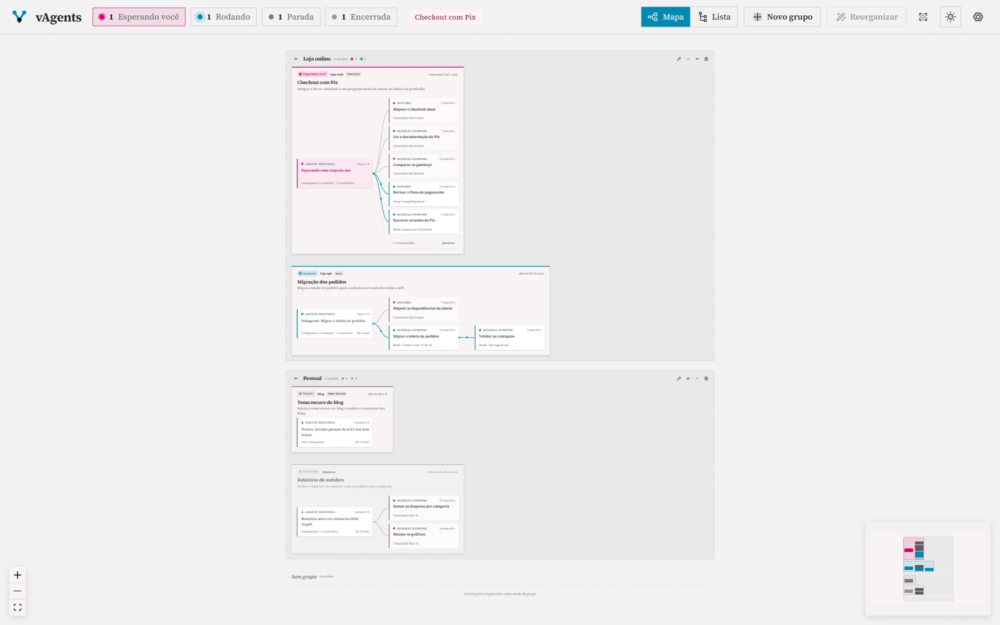
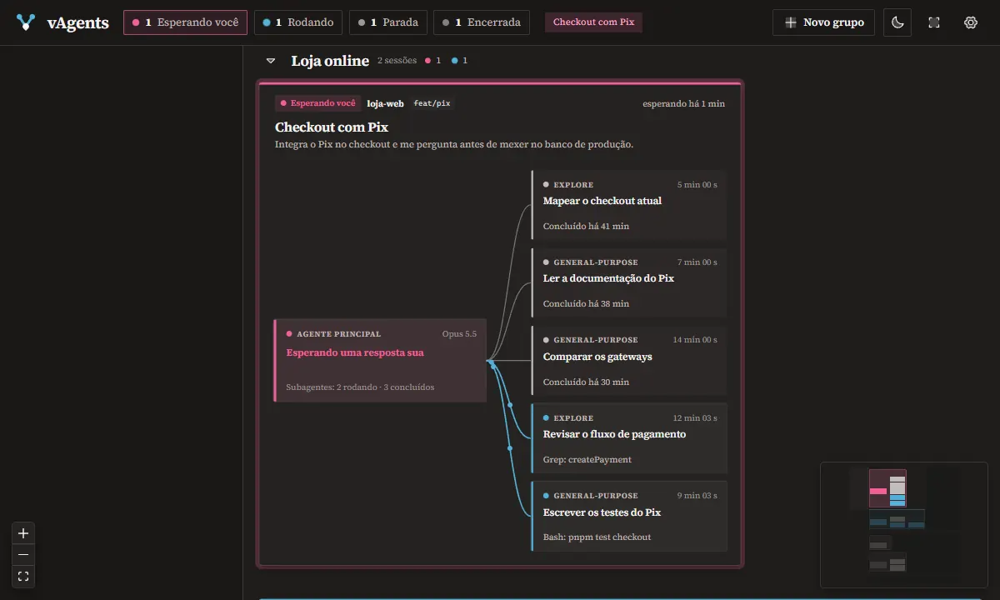
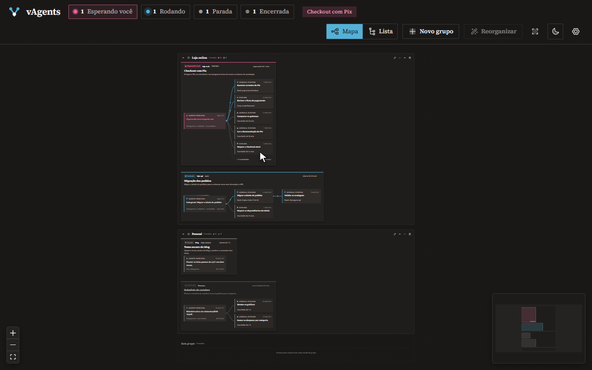
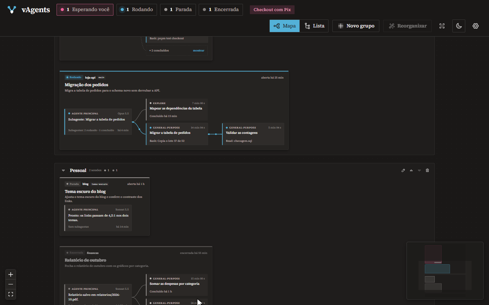
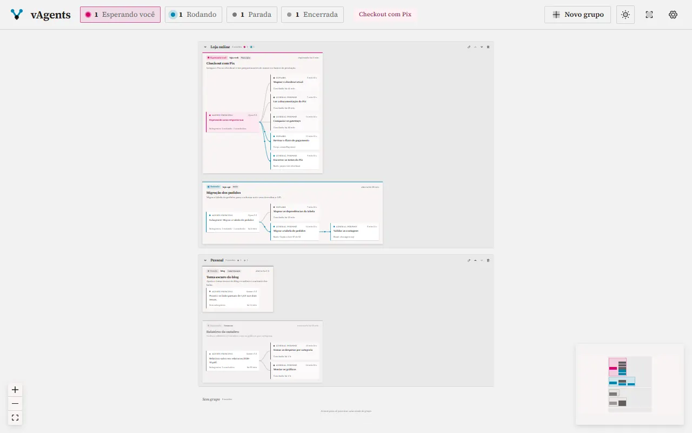
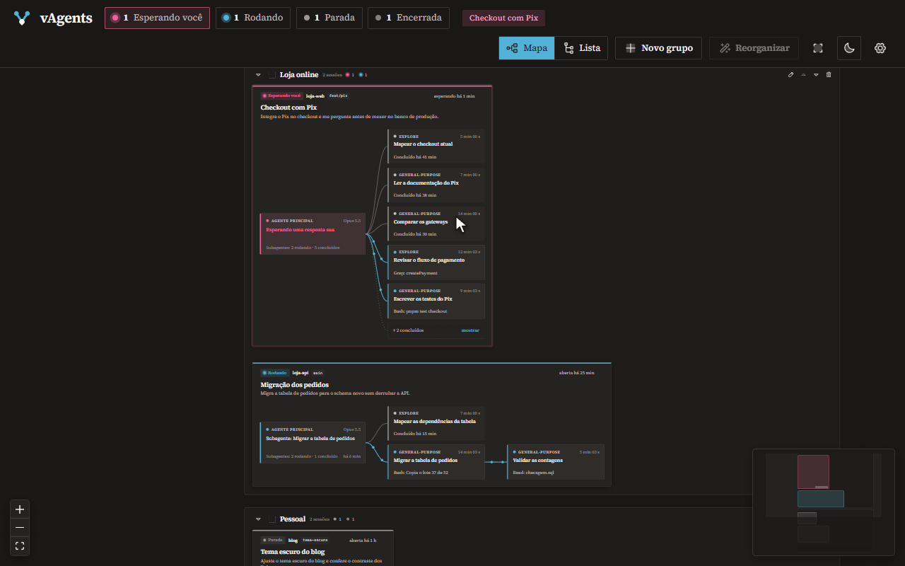
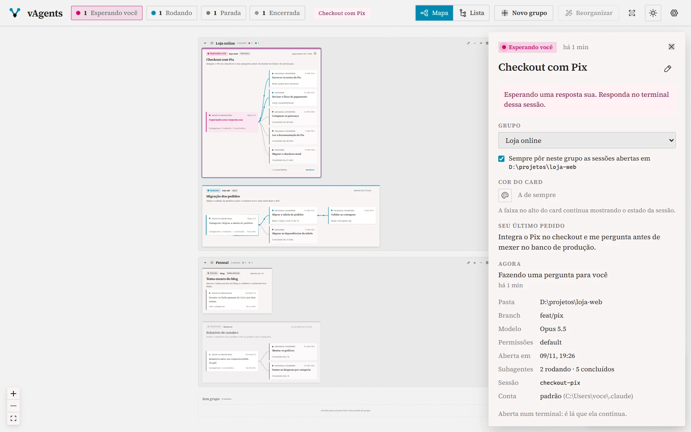
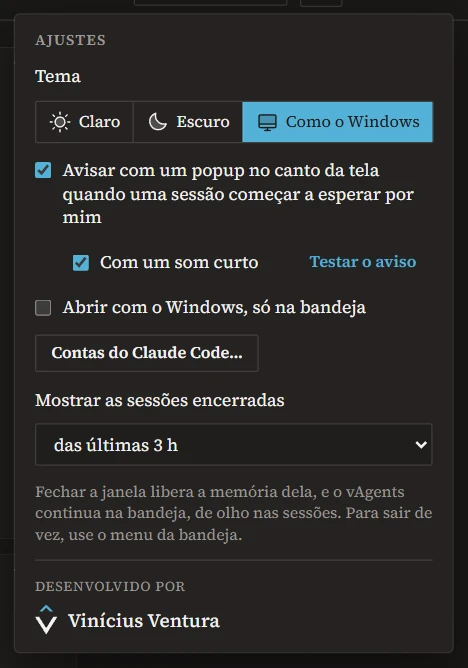
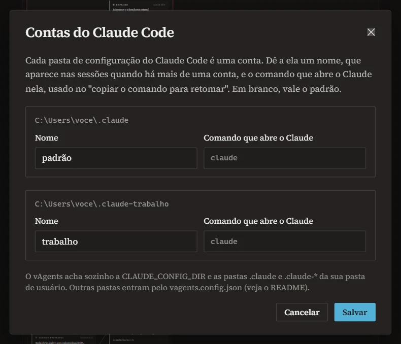

<div align="center">


# vAgents

**As sessões do Claude Code que estão abertas, numa tela só.**

O que cada sessão está fazendo, a árvore dos subagentes dela<br>
e quem está esperando por você, ao vivo, sem caçar terminal.

<br>

[](../../releases/latest)


</div>

<br>

<picture>
  <source media="(prefers-color-scheme: dark)" srcset="docs/tela-escuro.webp">
  
</picture>

<p align="center">
  <a href="#baixar-e-instalar"><b>Baixar</b></a> &nbsp;·&nbsp;
  <a href="#primeiros-passos">Primeiros passos</a> &nbsp;·&nbsp;
  <a href="#o-que-ele-faz">O que ele faz</a> &nbsp;·&nbsp;
  <a href="#perguntas-frequentes">Perguntas</a> &nbsp;·&nbsp;
  <a href="#privacidade-e-segurança">Privacidade</a> &nbsp;·&nbsp;
  <a href="#desenvolver">Desenvolver</a>
</p>

<details>
<summary><b>In English</b></summary>
<br>

vAgents is a Windows desktop app that shows every Claude Code session open on your machine, live, on
one screen. Each session is a card with its topic, your last request and its state (running, waiting
for you, idle or ended), plus the tree from the main agent down to its subagents (and the ones they
spawn), with each agent's current step. When a session starts waiting for you, a small popup slides in
from the corner, with a short chime, without stealing focus. Switch between the map and a tree list
(collapse or expand each item, or everything at once). Group sessions on the fly (drag a card into a
group, or set a rule per folder), place the cards wherever you like on the map (one click puts them
back in the automatic layout), give each group and each card a color of your own (any color, or its
hex), rename them, and name each Claude Code account. Closing the window
leaves it in the tray at about 8 MB. It only reads the files Claude Code already writes: no
hooks, no account, no network. Built with Tauri 2, Rust and React; the interface is in Brazilian
Portuguese. [Download the latest installer](../../releases/latest).

</details>

## Por quê

Com o Claude Code, é comum ter três ou quatro sessões abertas, cada uma soltando subagentes. Elas
ficam espalhadas em abas de terminal, e a que travou esperando uma resposta sua passa despercebida por
meia hora. O vAgents junta tudo numa tela: o que cada sessão está fazendo, quem ela pôs para trabalhar
e quem precisa de você agora.

## Baixar e instalar

1. **Baixe** o `vAgents_x.y.z_x64-setup.exe` na [página da versão mais recente](../../releases/latest).
2. **Abra o instalador.** Ele instala só para você, sem pedir administrador, em `%LOCALAPPDATA%\vAgents`.
3. **Abra o vAgents** pelo menu Iniciar. Ele acha sozinho as sessões do Claude Code desta máquina.

> [!IMPORTANT]
> O instalador ainda não tem assinatura de código, por isso o Windows pode mostrar **"O Windows
> protegeu o computador"**. Clique em **Mais informações** e depois em **Executar assim mesmo**.

- **Sistema:** Windows 10 ou 11, de 64 bits. O WebView2 já vem no Windows 11; no 10, o instalador o
  baixa se faltar.
- **Claude Code:** 2.1 ou mais novo (testado no 2.1.319). O vAgents só lê os arquivos que ele grava;
  veja [De onde vêm os dados](#de-onde-vêm-os-dados).
- **Atualizar:** baixe e rode o instalador novo. Os grupos, os nomes e as preferências ficam.
- **Desinstalar:** Configurações → Apps → vAgents.

## Primeiros passos

1. **Abra o vAgents** com algumas sessões do Claude Code rodando. Cada uma vira uma caixa, com a árvore
   dos subagentes dela, e a barra de cima conta quantas estão rodando, esperando você, paradas ou
   encerradas. Prefere uma lista? Clique em **Lista**, no alto.
2. **Organize.** Arraste uma sessão pelo cabeçalho até o aviso "solte aqui para criar um grupo com ela"
   e dê um nome ao grupo (o quadradinho ao lado do nome escolhe a cor dele). As próximas você arrasta
   para dentro dele, e cada card fica onde você o soltar.
3. **Clique numa sessão** para ver tudo dela no painel ao lado.
4. **Feche a janela.** O vAgents fica na bandeja e avisa, com um popup no canto da tela, quando alguma
   sessão esperar por você. Para conferir como ele é, use "Testar o aviso" nos Ajustes.

## O que ele faz

### A árvore de cada sessão, ao vivo

Cada sessão é uma caixa com o **tema** (o título que o Claude dá a ela, ou o nome que você der), a
**descrição** (o seu último pedido) e o **estado**. Dentro, a árvore: do agente principal saem os
subagentes, e deles os que eles criaram, cada um com o tipo, o tempo e o passo atual
(`Bash: pnpm test`, `Read: checkout.ts`). As ligações dos que estão rodando ganham pontos correndo; a
sessão que espera por você pulsa em magenta.



Os concluídos antigos se recolhem num "+N", que abre num clique. Com muitos filhos (um workflow de
cem agentes, por exemplo), a árvore vira colunas ligadas por um barramento, sem cruzar as caixas. Os
números da barra de cima enquadram as sessões de cada estado, e o atalho com o nome da sessão que
espera por você leva direto a ela.

### No mapa ou numa lista

**Mapa** e **Lista**, no alto, trocam a visualização (a escolha fica guardada). A lista mostra o mesmo
que o mapa, como um explorador de arquivos: os grupos, dentro deles as sessões, e dentro de cada sessão
a árvore dos subagentes, com colunas para o projeto, o estado, o passo atual e o tempo. A seta de cada
item recolhe ou expande só ele, e **Recolher tudo** e **Expandir tudo** fazem isso com a lista inteira,
grupos incluídos. Dá para andar pelo teclado (as setas, e Enter abre os detalhes), e os números da barra
de cima rolam até as sessões de cada estado e as fazem piscar.



### Quem está esperando por você


Quando uma sessão começa a esperar por você (uma pergunta, uma permissão), um popup pequeno desliza no
canto da tela, com um toque curto. Ele **não rouba o foco** do que você está fazendo, some sozinho em
alguns segundos (e espera enquanto o mouse está em cima) e, com um clique, abre o vAgents naquela
sessão.

Com o Windows numa apresentação ou num jogo em tela cheia, ele fica quieto. O ícone da bandeja e o da
barra de tarefas ganham um ponto magenta enquanto alguém espera, e o título da janela diz quantas.

<br clear="right">

### Organizar na hora

No mapa, arraste o card pelo cabeçalho e solte onde quiser: lado a lado, um embaixo do outro, do jeito
que fizer sentido para você. Ele fica onde você o deixou, e o card que cresce (porque a sessão criou
mais subagentes) empurra o vizinho, em vez de ficar por cima dele. **Reorganizar**, no alto, devolve
todos os cards à organização automática.



Solto em outro grupo, o card muda de grupo; em "sem grupo", sai do grupo; no aviso "solte aqui para
criar um grupo com ela", cria um grupo novo, que já nasce com o nome aberto para você digitar. Na lista,
arraste a linha da sessão do mesmo jeito. Duplo clique renomeia o grupo ou a sessão (apagar o nome volta
ao título do Claude); os botões do grupo sobem, descem, recolhem e apagam.



No painel da sessão, **"sempre pôr neste grupo as sessões abertas em <pasta>"** cria uma regra: as
sessões que você abrir depois naquela pasta (ou numa subpasta) já entram no grupo. A escolha feita
numa sessão vale mais que a regra.

### Cores

Por padrão, tudo fica com as cores de sempre; a cor é só se você quiser. O quadradinho ao lado do nome
do grupo abre o seletor de cor: escolha qualquer cor na área de cor e na faixa de matiz, numa das
cores prontas, ou digite o hex. O quadro do grupo fica com um tom dela, e a borda também. Cada card
pode ter a sua cor do mesmo jeito: o botão aparece no canto do card quando o mouse passa por ele (e
também no painel da sessão, e antes do nome, na lista). A faixa no alto do card continua mostrando o
estado da sessão. **Usar o padrão** volta à cor de sempre.



### Tudo de uma sessão, num clique

O painel mostra o seu último pedido inteiro, o passo atual, a pasta, a branch, o modelo, o modo de
permissão, quantos subagentes rodam e terminaram, e a conta. Numa sessão encerrada, ele copia o
comando para retomá-la (`claude --resume …`, já na pasta e na conta certas).



### Do seu jeito

<p align="center">
  
  &nbsp;
  
</p>

- **Contas do Claude Code:** usa mais de uma? O vAgents acha todas (a `CLAUDE_CONFIG_DIR` e as pastas
  `.claude` e `.claude-*` do seu usuário). Em "Contas do Claude Code…", dê a cada uma um nome e o
  comando que abre o Claude nela.
- **Tema:** claro ou escuro, no botão do sol e da lua; nos Ajustes, também "Como o Windows".
- **Aviso e som:** liga e desliga cada um; as sessões encerradas ficam na lista por 1, 3 ou 24 horas.

### Leve na bandeja

Fechar a janela tira a tela da memória: na bandeja, o vAgents usa uns **8 MB** e continua de olho nas
sessões e avisando. Com a janela aberta, uns 300 MB, quase tudo do WebView2 (o motor do Edge que
desenha a tela); reabrir leva menos de um segundo. "Abrir com o Windows", nos Ajustes, liga junto com o
computador, só na bandeja.

## Perguntas frequentes

<details>
<summary><b>É de graça?</b></summary>
<br>

Sim. O código é aberto, com a [licença MIT](LICENSE).

</details>

<details>
<summary><b>Funciona no Mac ou no Linux?</b></summary>
<br>

Ainda não. O instalador é só para Windows: a bandeja, o popup, o som e a checagem dos processos foram
feitos e testados lá. A leitura das sessões (`src-tauri/sessoes`) não depende do Windows.

</details>

<details>
<summary><b>Meus dados vão para algum lugar?</b></summary>
<br>

Não. Sem conta, sem servidor, sem telemetria, sem rede. O vAgents só lê os arquivos que o Claude Code
grava na sua pasta de usuário, e guarda o que é seu em `%APPDATA%\br.com.viniciusventura.vagents\`. Veja
[Privacidade e segurança](#privacidade-e-segurança).

</details>

<details>
<summary><b>Por que o Windows avisa na instalação?</b></summary>
<br>

O instalador não tem assinatura de código, que é cara para um projeto pessoal. Em "O Windows protegeu o
computador", clique em **Mais informações → Executar assim mesmo**. O código está todo aqui, para quem
quiser conferir ou [gerar o próprio instalador](#desenvolver).

</details>

<details>
<summary><b>Meu Claude Code fica numa pasta diferente. Ele acha?</b></summary>
<br>

Ele acha sozinho a `CLAUDE_CONFIG_DIR` e as pastas `.claude` e `.claude-*` da sua pasta de usuário que
tenham `projects` ou `sessions`. Para observar outras pastas, crie o `vagents.config.json` na pasta de
dados (`%APPDATA%\br.com.viniciusventura.vagents\`):

```json
{
  "pastas": ["D:/claude/pessoal", "D:/claude/trabalho"],
  "retencaoHoras": 24
}
```

Com `"pastas"`, valem exatamente as listadas; `"retencaoHoras"` diz por quanto tempo uma sessão
encerrada continua na lista. O nome e o comando de cada conta continuam em "Contas do Claude Code…",
nos Ajustes.

</details>

<details>
<summary><b>Uma sessão aparece com o estado errado, ou não aparece.</b></summary>
<br>

O vAgents lê arquivos internos do Claude Code, que não são uma API: uma atualização pode mudá-los. Ele
foi feito e testado no Claude Code 2.1.319. Se algo parar de bater depois de atualizar o Claude Code,
[abra uma issue](../../issues) com a versão; o conserto fica num lugar só, `src-tauri/sessoes`.

</details>

<details>
<summary><b>O popup não apareceu.</b></summary>
<br>

Confira, nos Ajustes, se o aviso está ligado, e use "Testar o aviso". Com o Windows em apresentação, num
jogo em tela cheia ou com a tela bloqueada, o aviso fica quieto de propósito. Uma janela que você mesmo
abriu no terminal (como o `/config`) também não avisa.

</details>

## Privacidade e segurança

- **Nada sai do seu computador.** O vAgents não usa a rede: nem atualização automática, nem telemetria.
  Um link (como o do site do autor) abre no seu navegador, nunca dentro do app.
- **Ele só lê.** Os históricos do Claude Code têm tudo o que você conversou com ele; o vAgents os lê
  para montar a tela e não escreve neles nem os copia para lugar nenhum.
- **A interface é fechada**: só conversa com o núcleo pelo IPC do Tauri, a política de conteúdo (CSP) só
  aceita o que vem do próprio app e a janela não navega para fora dele.
- **"Abrir com o Windows"** grava a entrada de sempre em `HKCU\...\Run`, e só quando você liga.

### De onde vêm os dados

Nada de hooks nem de configuração no Claude Code: o vAgents lê, a cada segundo, o que ele já grava.

| Arquivo | O que dá |
| --- | --- |
| `<config>/sessions/<pid>.json` | as sessões abertas e o estado: `status` = `busy`, `idle` ou `waiting` (com `waitingFor`) |
| `<config>/projects/<pasta>/<sessão>.jsonl` | o histórico: `ai-title` (tema), `last-prompt` (descrição), o passo atual, o modelo e a branch |
| `<config>/projects/<pasta>/<sessão>/subagents/agent-<id>.meta.json` | cada subagente: tipo, descrição, `spawnDepth`, `toolUseId` (quem o criou) e `finished` |
| `<config>/projects/<pasta>/<sessão>/subagents/agent-<id>.jsonl` | o passo atual de cada subagente |

Os históricos são lidos do fim para o começo e depois só no que cresce, então arquivos de dezenas de
MB não pesam.

## Desenvolver

Precisa do Windows, do [Node](https://nodejs.org) 22+ com o [pnpm](https://pnpm.io) e do
[Rust](https://rustup.rs) com o toolchain MSVC (o do Visual Studio Build Tools).

```sh
pnpm install
pnpm app          # o vAgents em desenvolvimento (Tauri + Vite, com recarga)
pnpm dev          # só a interface no navegador, com sessões de exemplo (bom para mexer no visual)
pnpm app:build    # o instalador, em src-tauri\target\release\bundle\nsis\
```

```sh
pnpm test && pnpm typecheck
pnpm test:rust    # a leitura das sessões (src-tauri/sessoes) e a casca
```

<details>
<summary><b>Inspecionar o app de verdade</b></summary>
<br>

Com o DevTools remoto do WebView2, dá para inspecionar e dirigir o app em `http://127.0.0.1:9333` (pelo
`edge://inspect` ou pelo protocolo do DevTools), com as suas sessões reais. Em `pnpm dev`, `?aviso` na
URL mostra o popup de exemplo.

```sh
WEBVIEW2_ADDITIONAL_BROWSER_ARGUMENTS=--remote-debugging-port=9333 pnpm app
```

Feche antes o vAgents instalado: os dois usam o mesmo identificador, e o de desenvolvimento só traria a
janela do instalado. Há também um teste, desligado por padrão, que lê as sessões reais desta máquina
(só leitura):

```sh
cargo test --manifest-path src-tauri/sessoes/Cargo.toml --test dados_reais -- --ignored --nocapture
```

</details>

<details>
<summary><b>Publicar uma versão</b></summary>
<br>

Suba a versão em `package.json`, `src-tauri/Cargo.toml` e `src-tauri/tauri.conf.json`, anote no
[CHANGELOG](CHANGELOG.md), gere o instalador com `pnpm app:build` e anexe-o a uma Release do GitHub:

```sh
gh release create v0.1.0 src-tauri/target/release/bundle/nsis/vAgents_0.1.0_x64-setup.exe --title "vAgents 0.1.0" --notes-file docs/release-0.1.0.md
```

O botão "Baixar para Windows" aponta para a Release mais recente.

</details>

<details>
<summary><b>Por dentro</b></summary>
<br>

- **[Tauri 2](https://tauri.app)**: o núcleo em Rust lê as sessões numa linha de fundo, fica na bandeja,
  mostra o popup e toca o som. O Tauri usa o WebView2 que já vem no Windows, então o instalador tem 2 MB.
- **React 19, Vite, Tailwind 4 e [React Flow](https://reactflow.dev)** na interface. A organização é um
  JSON, sem banco.

```
src-tauri/sessoes/   a leitura das sessões do Claude Code (Rust, sem Tauri, com testes próprios)
  registry.rs        sessions/<pid>.json: as sessões abertas e o estado
  transcript.rs      o que interessa nos históricos (tema, pedido, passo atual)
  subagents.rs       os subagentes e quem criou quem
  monitor.rs         o retrato de todas as sessões, a cada segundo, só quando muda
src-tauri/src/
  lib.rs             a janela, os comandos, as contas e a linha que acompanha as sessões
  janela.rs          a bandeja, o ponto de "esperando você" e a janela que é criada e destruída
  aviso.rs           o popup, o som (sintetizado na hora) e o respeito ao "não incomodar"
  avisos.rs          quando avisar (só a sessão que passou a esperar, sem rajadas)
src/
  layout.ts          as caixas, as árvores, os grupos, o "pente" das ligações e os cards arrumados à mão
  lib/lista.ts       a lista: as linhas, o recolher e o expandir
  lib/organizacao.ts os grupos, os nomes, as cores, o lugar dos cards e as regras por pasta
  lib/cor.ts         o hex e as contas do seletor de cor (matiz, saturação e brilho)
  nodes.tsx, App.tsx a tela; Lista.tsx, a lista; SeletorDeCor.tsx, o seletor de cor
  Aviso.tsx          o popup; ContasDoClaude.tsx, as contas
  demo.ts            as sessões de exemplo do pnpm dev
```

</details>

## Licença

O código é [MIT](LICENSE). O símbolo (o V de agentes) e a identidade visual são da marca
[Vinícius Ventura](https://viniciusventura.com.br) e não entram na licença: num fork, troque o ícone
(`src-tauri/icons/fonte.svg`, que o `pnpm tauri icon` transforma no resto), o símbolo (`src/Marca.tsx`)
e o crédito (`src/Credito.tsx`).

A fonte é a [Source Serif 4](https://github.com/adobe-fonts/source-serif) (SIL Open Font License), os
ícones são do [Phosphor](https://phosphoricons.com) (MIT) e o canvas é do
[React Flow](https://reactflow.dev) (MIT). As sessões nas imagens são de exemplo. vAgents não é um
produto da Anthropic; Claude e Claude Code são marcas dela.

<br>

<p align="center">
  <sub>Feito por <a href="https://viniciusventura.com.br">Vinícius Ventura</a></sub>
</p>
