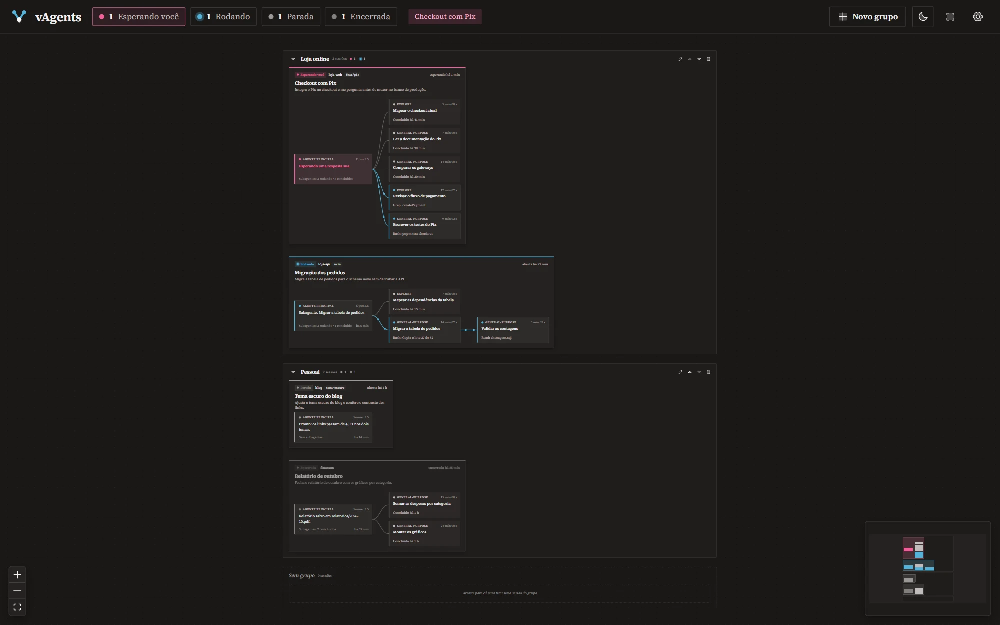

A primeira versão do vAgents: as sessões do Claude Code que estão abertas na sua máquina, numa tela só.

**O que tem**

- Uma caixa por sessão, com o tema, o seu último pedido e o estado: rodando, esperando você, parada ou encerrada.
- A árvore do agente principal até os subagentes (e os que eles criaram), com o passo atual de cada um.
- Um popup pequeno no canto da tela, com um toque curto, quando uma sessão começa a esperar por você. Não rouba o foco e fica quieto em apresentações e em tela cheia.
- Grupos com nome, criados na hora: arraste as sessões, ou deixe uma regra por pasta.
- Todas as contas do Claude Code, achadas sozinhas; nos Ajustes, cada uma ganha um nome e o comando que a abre.
- Na bandeja, com a janela fechada, o vAgents usa uns 8 MB.

**Instalar:** baixe o `vAgents_0.1.0_x64-setup.exe` abaixo e abra. Ele instala só para você, sem pedir administrador. O instalador ainda não tem assinatura de código: se o Windows avisar, clique em **Mais informações → Executar assim mesmo**.

**Precisa de:** Windows 10 ou 11 (64 bits) e o Claude Code 2.1 ou mais novo (testado no 2.1.319).
