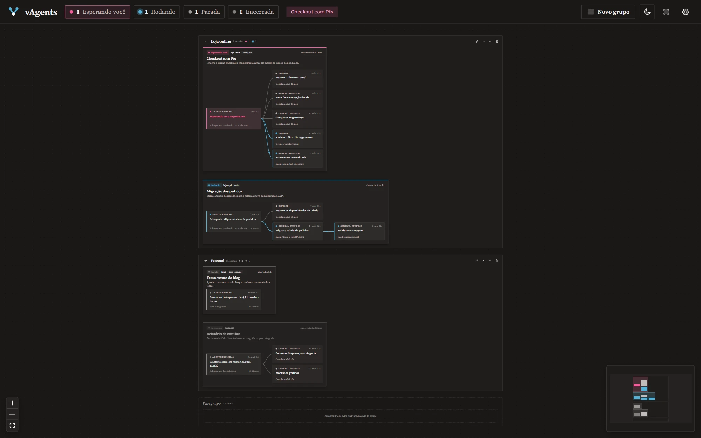

Os subagentes mais recentes em cima, uma luz no agente principal enquanto ele roda e a paleta no botão de cor.

**O que mudou desde a 0.1.0**

- **Os mais recentes em cima:** entre os subagentes de um mesmo pai, os que estão rodando vêm primeiro, depois os que terminaram, do mais recente ao mais antigo; os mais antigos continuam dobrados no "+N". Vale no mapa e na lista.
- **O agente principal rodando:** uma luz dá a volta no card dele, como os pontos que correm nas ligações dos subagentes. Com os "Efeitos de animação" do Windows desligados, vira um contorno parado.
- **A paleta:** sem cor escolhida, o botão de cor do grupo e do card mostra o ícone da paleta (antes, um quadrado tracejado que não dizia para que servia).

**Instalar:** baixe o `vAgents_0.1.1_x64-setup.exe` abaixo e abra. Ele instala só para você, sem pedir administrador. Se a 0.1.0 já estiver instalada, instale por cima: os seus grupos, nomes e cores ficam. O instalador ainda não tem assinatura de código: se o Windows avisar, clique em **Mais informações → Executar assim mesmo**.

**Precisa de:** Windows 10 ou 11 (64 bits) e o Claude Code 2.1 ou mais novo (testado no 2.1.319).
