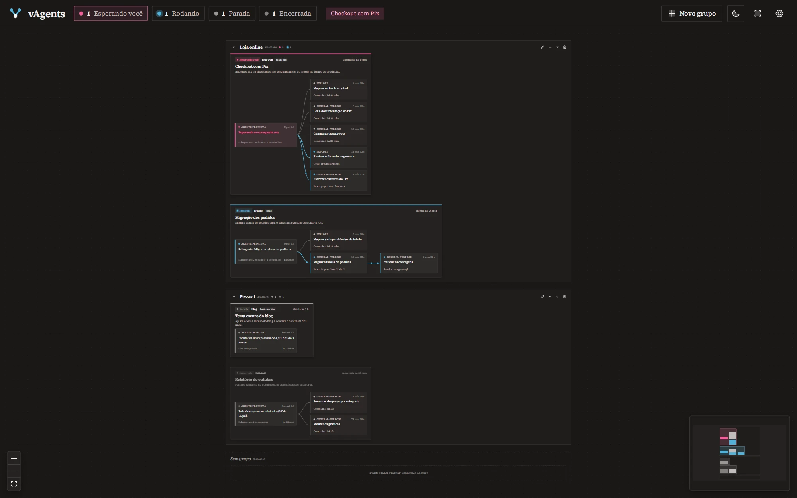

O aviso de "terminou", um som para cada aviso (madeira, sinos, gota, acorde ou um arquivo seu) e a pílula de versão nova.

**O que mudou desde a 0.1.1**

- **O aviso de "terminou":** quando uma sessão termina o que estava fazendo e fica parada, pronta para o próximo pedido, vem o mesmo popup do "esperando você", em cinza, com quanto tempo ela trabalhou ("Terminou em 4 min"). Ele só vem depois de 15 s ou mais de trabalho e espera os subagentes em segundo plano acabarem. Tem a sua chave nos Ajustes e no menu da bandeja.
- **Um som para cada aviso:** nos Ajustes, cada aviso tem a sua lista: madeira, com uma ou duas batidas (o novo padrão: duas para "esperando você", uma para "terminou"), sino, sino descendo, gota, acorde, nenhum ou um arquivo seu (MP3, WAV, OGG ou M4A), que vira um toque curto, no mesmo volume dos outros. Escolher na lista já toca; o "Testar" mostra o popup.
- **Os Ajustes dos avisos:** os dois avisos num bloco só, cada um com a cor do popup dele, o som e o teste.
- **Versão nova:** quando sai uma, uma pílula discreta na barra de cima abre a página dela, e o × a dispensa. Para isso, o vAgents consulta a última versão na API pública do GitHub, no máximo a cada 6 h, sem mandar nada seu. É a única conexão do app, e se desliga nos Ajustes ("Avisar quando sair uma versão nova").

**Instalar:** baixe o `vAgents_0.2.0_x64-setup.exe` abaixo e abra. Ele instala só para você, sem pedir administrador. Se uma versão anterior já estiver instalada, instale por cima: os seus grupos, nomes, cores e preferências ficam. O instalador ainda não tem assinatura de código: se o Windows avisar, clique em **Mais informações → Executar assim mesmo**.

**Precisa de:** Windows 10 ou 11 (64 bits) e o Claude Code 2.1 ou mais novo (testado no 2.1.322).
